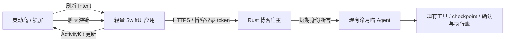

# 接口与结构

## 宿主 API

| 场景 | 入口 | 处理 |
| --- | --- | --- |
| 登录 | `POST /api/login` | `{username,password}` → `ApiResponse<String>`，检查 HTTP 与业务 code |
| 登录校验 | `GET /api/protected/profile` | 只接受宿主真实登录 token |
| 服务器指标 | `GET /api/protected/diagnostics` | `data.schemaVersion=1`，`host.cpuPercent`、`host.memory`、`services`，管理员专用 |
| 近期文章 | `GET /api/public/articles?page=1&page_size=5` | 公共元数据列表，标题不当作正文证据 |
| 创建会话 | `POST /api/chat/conversations` | 返回 `id`，不在客户端制造会话编号 |
| 聊天 | `POST /api/chat/stream` | `X-Agent-Stream-Version: 2`；传 `conversation_id`、`turn_id`、新轮 `task_id` |
| 暂停任务 | `GET /api/chat/tasks` | 读取 `paused.items`；保留 `unavailable` 的失败含义 |
| 历史 | `GET /api/chat/history?conversation_id=…` | 恢复暂停任务所属会话的最近窗口 |
| 当前确认卡 | `POST /api/chat/task/confirmation` | 读取真实 checkpoint 投影，不重签授权 |
| 确认文本操作 | `POST /api/chat/stream` | 空 `message` + 原始 `confirm_token`；不自动重试 |
| 撤销确认卡 | `POST /api/chat/confirmation/cancel` | `{conversation_id,token}`；必须收到 `cancelled:true` |
| 取消暂停任务 | `POST /api/chat/tasks/cancel` | `{conversation_id,task_id}`；不撤销已完成业务 |

没有新增移动端网关、模型服务或 HTTP 演示后端。演示运行在应用内部，真实模式使用上述已存在的宿主端点。

## 模块

- `Core`：独立 Swift Package，承载 JSON 类型、HTTPS 客户端、SSE 解码、确认卡及概览投影。
- `App`：主线程状态管理、SwiftUI 页面、ActivityKit 启动和深链路由。
- `Shared`：应用和 Widget 共编译的实时活动属性、头像、刷新 Intent 和登录配置。Intent 在主应用进程执行，不通过 App Group 共享 token。
- `Widget`：实时活动四种布局。
- `Resources`：正式头像与独立美术许可。
- `Tests`：不调用模型或生产服务的协议测试。

## 更新与错误

按需刷新并行读取三项独立接口；一项失败不覆盖另一项成功。灵动岛只保存简短摘要，不保存 token、确认授权或聊天正文。展示内容标记 privacySensitive。

SSE 支持 UTF-8、CR/LF/CRLF、注释、多行 data、1 MiB 帧上限与 4 MiB 单轮上限。未知事件、非法帧、终态后的数据和缺少完成标记均失败。正文不按命令前缀解释。

客户端忽略浏览器控制命令的执行部分，设置 `browser_feedback:false`；不宣称网页已到达或编辑已完成。文本确认卡显示完整字段、正文和系统提示；未知详情结构、图片和批量选择禁止原生批准。

登录切换清空本地对话、确认卡与当前实时活动。确认 token 只保留在内存，钥匙串仅保存博客登录 token。HTTP 不允许重定向，避免登录凭据被发送到非预期来源。
