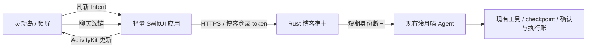

# 接口与结构

## 宿主 API

| 场景 | 入口 | 处理 |
| --- | --- | --- |
| 登录 | `POST /api/login` | `{username,password}` → `ApiResponse<String>`，检查 HTTP 与业务 code |
| 登录校验 | `GET /api/protected/profile` | 只接受宿主真实登录 token |
| 服务器指标 | `GET /api/protected/diagnostics` | `data.schemaVersion=1`，`host.cpuPercent`、`host.memory`、`services`，管理员专用 |
| 近期文章 | `GET /api/public/articles?page=1&page_size=5` | 公共元数据列表，标题不当作正文证据 |
| 创建会话 | `POST /api/chat/conversations` | 返回 `id`，不在客户端制造会话编号 |
| 聊天 | `POST /api/chat/stream` | `X-Agent-Stream-Version: 2`；传 `conversation_id`、`turn_id`、新轮 `task_id` |
| 暂停任务 | `GET /api/chat/tasks` | 读取 `paused.items`；保留 `unavailable` 的失败含义 |
| 历史 | `GET /api/chat/history?conversation_id=…` | 恢复暂停任务所属会话的最近窗口 |
| 当前确认卡 | `POST /api/chat/task/confirmation` | 读取真实 checkpoint 投影，不重签授权 |
| 确认文本操作 | `POST /api/chat/stream` | 空 `message` + 原始 `confirm_token`；不自动重试 |
| 撤销确认卡 | `POST /api/chat/confirmation/cancel` | `{conversation_id,token}`；必须收到 `cancelled:true` |
| 取消暂停任务 | `POST /api/chat/tasks/cancel` | `{conversation_id,task_id}`；不撤销已完成业务 |
| 人工审核数量 | `GET /api/protected/moderation/summary` | 评论与留言 `data.comments.pending` / `data.board.pending` |
| 评论待审 | `GET /api/protect/comments?status=pending&deleted=false&page=1&page_size=10` | 排除已删除、非待审记录；ID 为 `id` |
| 留言待审 | `GET /api/protect/board?status=pending&page=1&page_size=10` | ID 为 `talkKey`，非 `id` |
| 额度申请 | `GET /api/protected/quota/requests?status=pending&page=1&page_size=10` | `status:0`，数量使用 `total` 而非分页长度 |

没有新增移动端网关、模型服务或 HTTP 演示后端。演示运行在应用内部，真实模式使用上述已存在的宿主端点。

## 模块

- `Core`：独立 Swift Package，承载 JSON 类型、HTTPS 客户端、SSE 解码、确认卡及概览投影。
- `App`：主线程状态管理、SwiftUI 页面、ActivityKit 启动和深链路由。
- `Shared`：应用和 Widget 共编译的实时活动属性、头像、刷新 Intent 和登录配置。Intent 在主应用进程执行，不通过 App Group 共享 token。
- `Widget`：实时活动四种布局。
- `Resources`：透明头部与独立美术许可；贴纸和 AppIcon 位于 App，不进入 Widget。
- `tests`：不调用模型或生产服务的协议、取消和契约测试。

## 更新与错误

按需读取诊断、文章、暂停执行和人工待办；人工待办包含汇总与三个有界分页列表，一项失败不覆盖另一项成功。未知数量保留未知；灵动岛待办数来自人工业务队列，不来自暂停执行数。灵动岛只保存简短摘要，不保存 token、确认授权或聊天正文。展示内容标记 privacySensitive。没有后台轮询或保活模式。

SSE 支持 UTF-8、CR/LF/CRLF、注释、多行 data、1 MiB 帧和 4 MiB 单轮线缆上限。安全的未知扩展帧仅忽略（有界、不解码、不赋予权限）；已知事件仍校验。pending/receipts 验证形状后剥离内部载荷，结构化 progress 仅展示。非法已知帧和缺少 done 均失败；收到 done 立即完成并关闭该轮传输，不等待 TCP EOF。正文不按命令前缀解释。

每轮持有独立网络流句柄。用户停止和消费者取消向 URLSession 传播；正常 finish 不取消自己的生产任务。场景、页面可见性只记录，不主动取消。协议/网络失败保留错误，关闭本轮连接。确认卡保留为只读，需读取服务端当前投影再决定是否批准；批准不制造新的 turn_id，也不自动重发。

客户端忽略浏览器控制命令的执行部分，设置 `browser_feedback:false`；不宣称网页已到达或编辑已完成。文本确认卡显示完整字段、正文和系统提示；未知详情结构、图片和批量选择禁止原生批准。

登录切换清空本地对话、确认卡与当前实时活动。确认 token 只保留在内存，钥匙串仅保存博客登录 token。HTTP 不允许重定向，避免登录凭据被发送到非预期来源。
